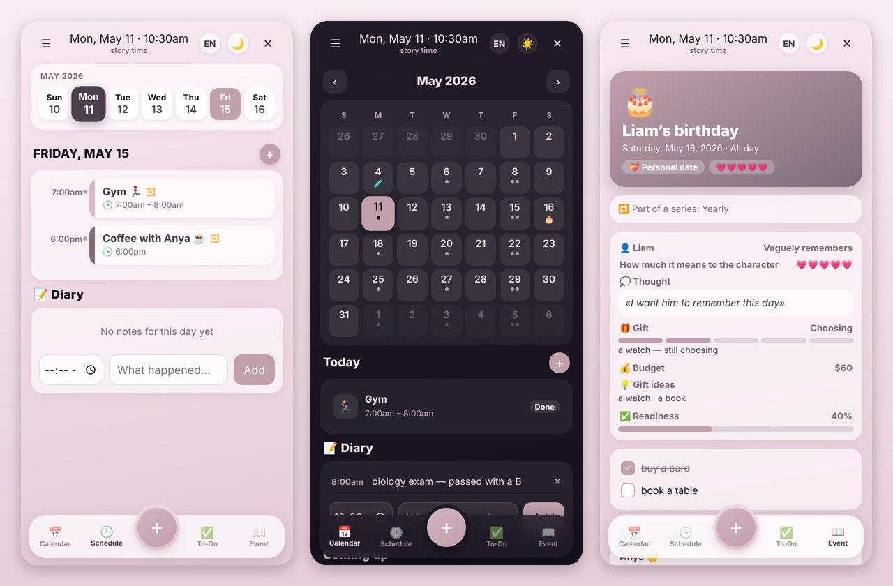
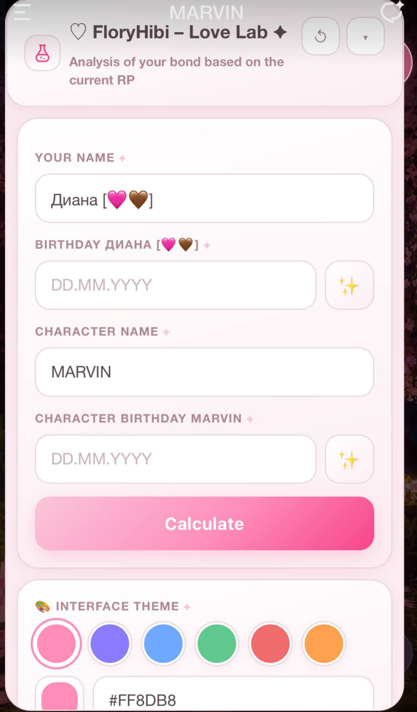
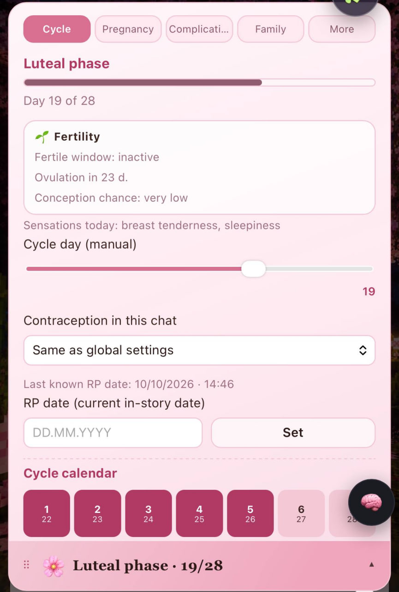
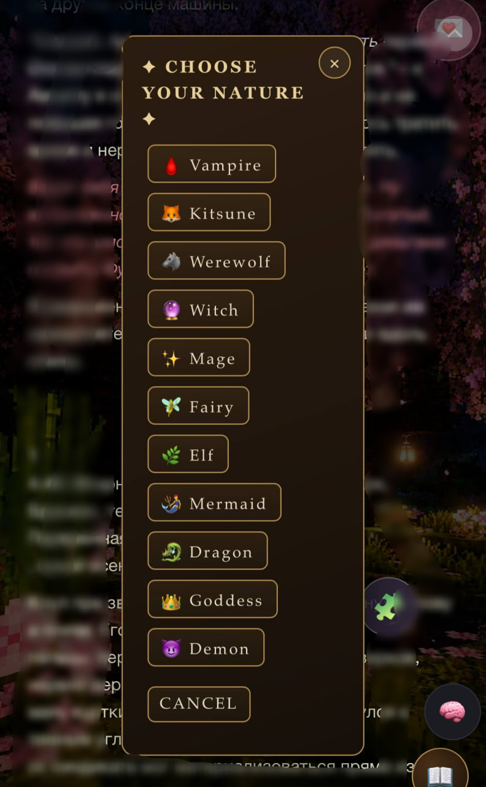
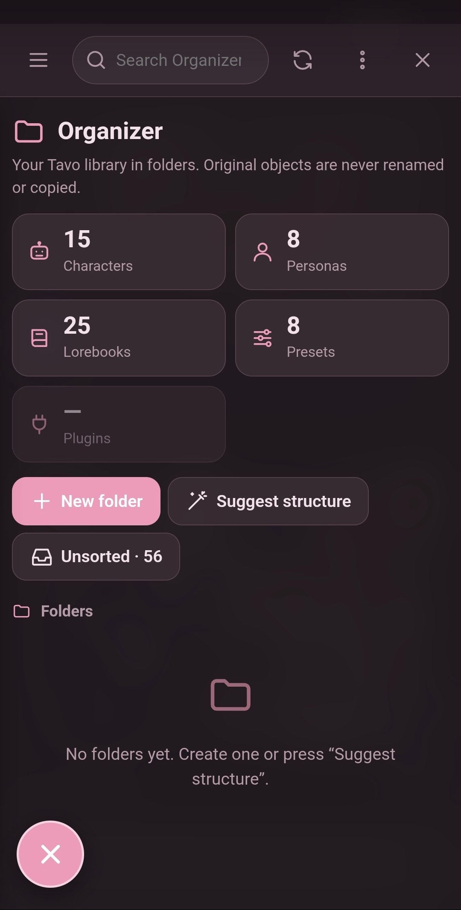
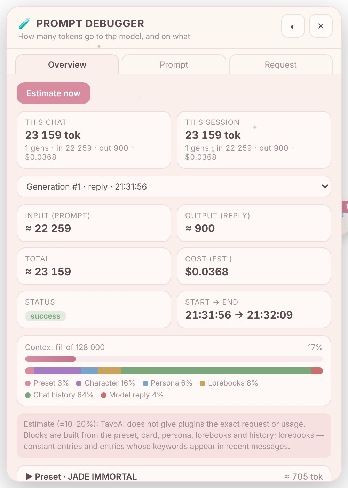
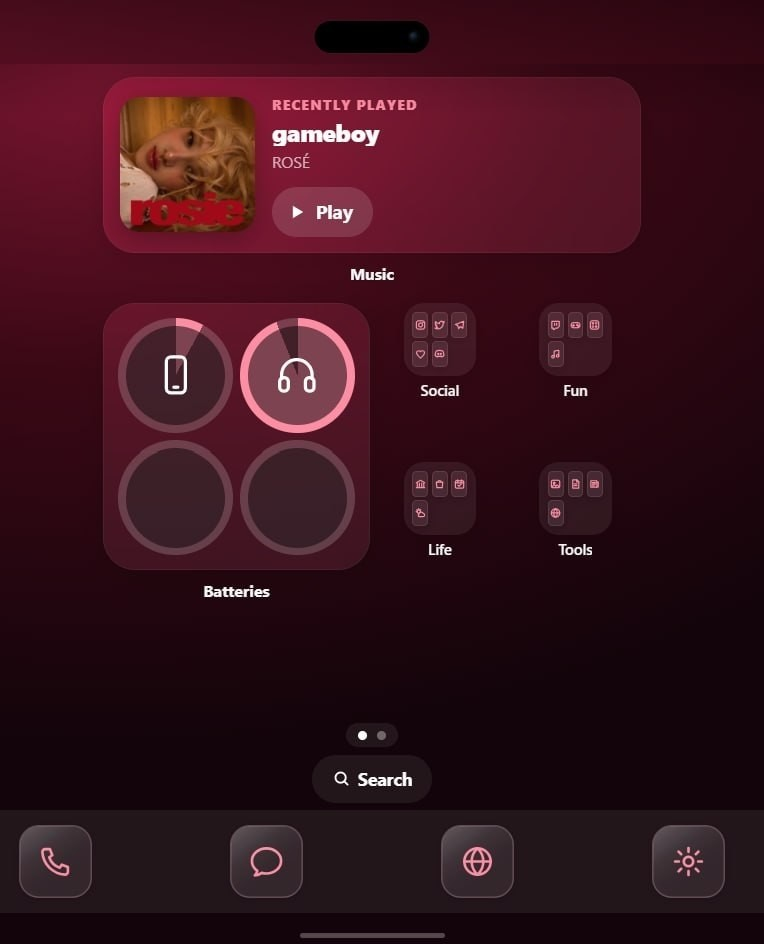
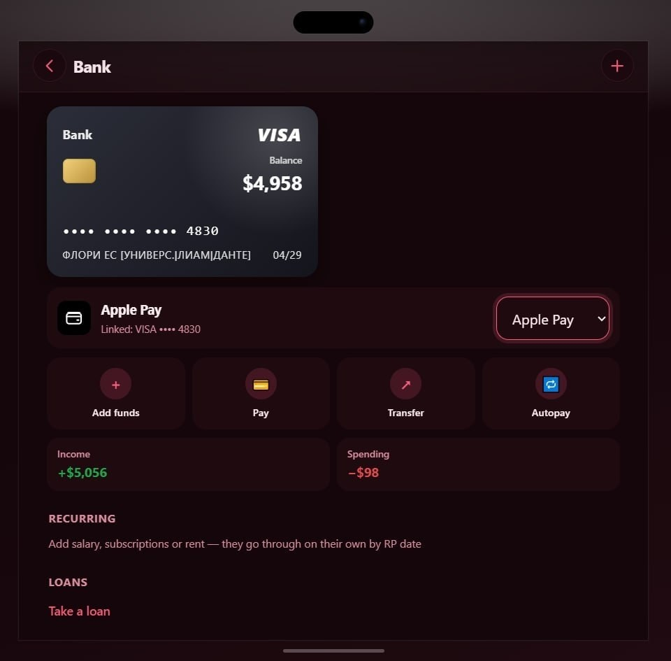
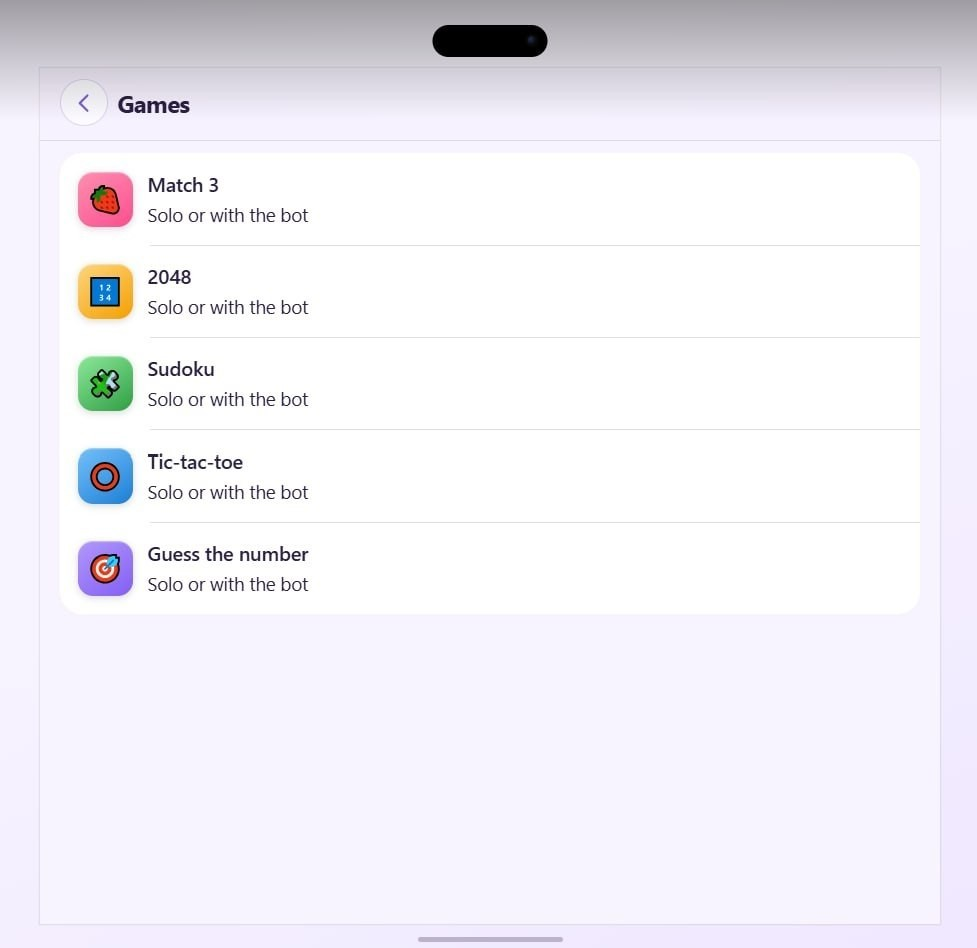

# 🧩 TavoAi Plugins by @floryhibi

> Ten modular plugins for **TavoAi** — an in-story calendar that makes the AI remember your schedule and holidays, a full smartphone inside your RP, relationships, biology, supernatural lore, character dossiers, estates, an AI companion watching your RP, a library organizer and a token debugger.

All plugins speak **EN/RU**, and Event Calendar, Organizer, Observer and Prompt Debugger also speak **中文** — the interface follows your TavoAi language automatically (Event Calendar also has its own language button).

---

## 📅 Event Calendar

Ever noticed how the model slacks on your schedule in a university or office roleplay? And holidays — it couldn't care less, until on your birthday your char suddenly pulls a gift out of thin air 😪 Event Calendar makes the AI **remember**: classes, work shifts, trainings, habits, daily routine, birthdays and holidays.

- **🕰 Story time, not real time** — follows the in-story date and time from the chat (works together with Phone and Reproductive System). A lecture from 10:00 to 12:00 doesn't end at 10:20 unless the story gives a reason; realistic, free and fixed-duration modes.
- **✨ Schedule from the roleplay** — reads the character, your persona and the chat, works out where you study or work (say, an architecture student) and proposes a weekly timetable with real subjects, times and rooms.
- **📅 Calendar** — month grid, day timeline with checklists, to-do list, event pages with lore; recurring events (weekdays, chosen days, monthly, yearly) with single-occurrence moves and cancellations.
- **🔔 The AI doesn't forget** — hidden reminders before events (a week … 5 minutes, for whom you choose), statuses (in progress, done, left early, missed, cancelled, moved), time skips reconciled, pop-up notifications in the chat.
- **🎊 Holidays & personal dates** — the closer the holiday, the more the world prepares; your char has thoughts about it and a gift that's prepared step by step; participants with their own plans and surprises; birthdays and anniversaries with "does the character know"; a recap the next day with consequences remembered.
- **📝 Diary, 🌙 dark theme, 🌐 RU / EN / 中** — the language button also switches the language of everything the plugin builds.

## 💘 Love Lab — Compatibility Laboratory

Analyses the bond between you and the character based on the current RP: zodiac compatibility, natal hints, relationship dynamics. Birth dates are found from the card/lore or generated by the model.

## 🤰 Reproductive System

Full cycle simulation synced with the in-story date: cycle calendar, phases, ovulation tracking, contraception, pregnancy and genetics. The RP date is detected from the text automatically.

## 👁 Observer

A meta-companion that watches your RP from the sidelines and reacts — emotional friend, snarky bestie or a detective hunting for plot contradictions. Runs on your own OpenAI-compatible API, never writes to chat history.

## 🦇 Supernatural Codex

A living book of supernatural natures: vampire, kitsune, werewolf, witch, mage, fairy, elf, mermaid, dragon, goddess, demon — plus custom species. Scans the character card, tracks resource, mastery, abilities, lineage, weaknesses and chronicle.

## 📂 Organizer

A library organization plugin for TavoAI. Folders, tags, favourites, smart folders and search — designed to keep your Tavo library organised without changing the original objects.

## 🧪 Prompt Debugger

See how many tokens every generation spends and what your prompt is made of: preset entries, character card, persona, triggered lorebook entries (constant + keyword), chat history and the model reply. Shows context-limit fill, block shares, cost at your prices, per-chat and per-session totals, and an **Estimate now** button to check the prompt size before you send. Numbers are estimates (±10–20%) — TavoAi does not expose the provider's exact token usage to plugins.

## 📱 Phone

A full iPhone inside your roleplay: lock screen with Face ID / passcode, Dynamic Island, notifications and smooth iOS-style animations. Text your character (photos, voice notes, reactions — they send selfies and text first when it fits the story), call each other, scroll Instagram, Twitter (X), Telegram channels, Discord, live streams and a dating app, answer anonymous questions and spread rumors in Whisper. Plus a bank with cards and Apple Pay, a shop with cart, bets on what happens next in the story with blackjack, roulette and a loan shark, music picked for the current scene, Google-style search, weather, notes, a gallery and games you can play against your character. Everything you do on the phone is quietly passed to the AI, and the phone's clock always follows the RP time.

  
  
  

## 🎨 Facets

Dossier generator: 26 topics of character tastes and traits (food, music, fears, habits…) rendered as a beautiful floating card panel.

## 🏠 Estate

Household and property system for your RP: homes, rooms, states and everything your characters own — visualized in one panel.

---

## ⬇️ Install

1. Download the `.tpg` files from the [**Releases**](https://github.com/floryhibi/Tavo_Plugins_by_floryhibi/releases/latest) page (Assets).
2. TavoAi → **Plugins** → import each `.tpg`.
3. Open the plugin panel and adjust settings.

## 🔗 Links

- 🌸 **PeonySet preset** — https://github.com/floryhibi/Tavo_PeonySet_by-floryhibi
- 🪷 **JadeImmortal preset** — https://github.com/floryhibi/Tavo_JadeImmortal_by-floryhibi
- 🏠 **Tavo Hub** — https://hub.tavoai.dev/creators/HQ4G1
- ☕ **Support me (Boosty)** — https://boosty.to/floryhibi
- 🌐 **Website** — https://floryhibi.ru
- 💬 **Discord** — https://discord.gg/zDH54uDArA

## 📜 License

[CC BY-NC 4.0](https://creativecommons.org/licenses/by-nc/4.0/) — share and adapt with credit, no commercial use.

---

made with 🌸 by <b>@floryhibi</b> 

